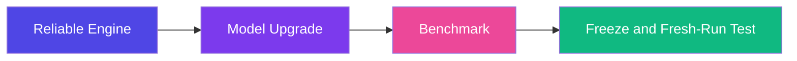
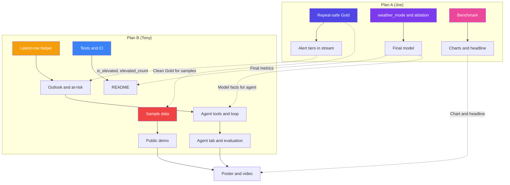

# 🚀 HyperLogistics-Stream — Two-Week Hackathon Implementation Plans

**Project:** HyperLogistics-Stream — Real-Time Hub-to-Hub ETA Prediction with Kafka and Spark Structured Streaming  
**Date:** October 27, 2026  
**Team:** Tony Nguyen, Joe Doan (2-person team, 2 plans)  
**Window:** Oct 27 – Nov 9, 2026 (submission Nov 9) · **Track:** AI / Data Science

> [!NOTE]
> **Update Oct 29:** direction changed after professor feedback (flight data only, data storytelling, live feed). See [PLAN_V2_LIVE_STORY.md](PLAN_V2_LIVE_STORY.md) for the current schedule. The engine, model and benchmark steps below still apply.

---

> [!IMPORTANT]
> Each plan has one owner and can run in parallel. Cross-plan dependencies are marked. Flights are a **public proxy** for hub-to-hub freight, and every deliverable states that limit plainly.

---

## 📋 Plan Overview

| Plan | Owner | Focus Areas | Key Deliverables | Est. Effort |
|------|-------|-------------|------------------|-------------|
| **Plan A** | Joe | Reliable stream engine, model upgrade, benchmark, demo sample data, README, poster draft | Repeat-safe Gold writes, ablation table, benchmark charts, frozen model, sample data | ~43 hrs |
| **Plan B** | Tony | API and dashboard action layer, natural-language agent, tests and CI, public demo, poster and video | Hub outlook, at-risk flights with reasons, dispatcher agent with evaluation, CI, demo link, 3-minute video | ~44 hrs |

**Capacity:** a few hours per day each over 14 days (about 3 hours a day on average). The agent (Plan B Steps 14 to 16, about 10 hours) is part of the plan because the track is AI / Data Science. To make room, Joe takes the demo sample files, the README and the first poster draft. The cut line near the end says what to drop first if time runs short.

---

# 🅰️ Plan A: Engine + Model + Benchmark

**Assigned to:** Joe Doan



---

## Phase A1: Reliable Stream Engine (Oct 27 – 29)

### Step 1 — Repeat-Safe Gold Writes and `--reset`
**File:** `pipeline/03_stream_processor.py` (modify)  
**Effort:** 4 hours

1. Add a `--reset` option that moves Bronze, Silver, both Gold folders and the checkpoint out of the way before the query starts. Rename on Drive instead of deleting, because a rename is instant:
   ```python
   parser.add_argument("--reset", action="store_true",
                       help="Move Bronze/Silver/Gold and the checkpoint aside before starting")
   ...
   if args.reset:
       stamp = time.strftime("%Y%m%d_%H%M%S")
       for key in ["bronze", "silver", "gold_predictions", "gold_congestion"]:
           p = resolve_path(cfg["paths"], key)
           if os.path.exists(p):
               os.rename(p, f"{p}_OLD_{stamp}")
       shutil.rmtree(checkpoint_root, ignore_errors=True)
   ```
2. Inside the `foreachBatch` function, call `df = df.dropDuplicates(["flight_id"])` before the Gold predictions write.
3. Document in the notebook: start the producer **without `--loop`** for demo runs, so each flight is sent once.

**Acceptance Criteria:**
- [ ] After a clean full run, Gold row count equals unique `flight_id` count
- [ ] `--reset` leaves empty output folders and a fresh checkpoint
- [ ] Old output is kept under `_OLD_<timestamp>` names, not lost

---

### Step 2 — Benchmark Isolation and Clean Replay
**Files:** `benchmark/run_benchmark.py`, `notebooks/02_colab_pipeline.ipynb` (check `scripts/build_notebook.py` first, in case the notebook is generated)  
**Effort:** 2 hours

1. **Check** whether `run_benchmark.py` writes to the same Gold folders as the demo run. If it does, point benchmark runs at a separate output root (or pass `--reset` after the sweep), because the sweep is a likely source of the many repeated rows seen earlier.
2. Run one clean replay: `--reset`, producer without `--loop`, stream job without `--test`, stop with Ctrl+C-style shutdown.
3. Verify with the check cell (rows vs unique `flight_id`).

**Acceptance Criteria:**
- [ ] Benchmark runs no longer add rows to the demo Gold tables
- [ ] Clean replay shows rows ≈ unique flights
- [ ] Notebook cells match the new flow (producer without `--loop`)

---

### Step 3 — Two Alert Tiers in the Stream
**Files:** `config/pipeline_config_colab.yaml`, `pipeline/03_stream_processor.py` (modify)  
**Effort:** 1 hour

1. Keep the official alert at 30 minutes (spec section 4.3) and add an "elevated" tier:
   ```yaml
   streaming:
     high_risk_threshold_min: 30.0     # official alert (spec 4.3, red on the map)
     elevated_threshold_min: 5.0       # second tier so demo charts are not empty
   ```
2. In the stream job, add `is_elevated` to the Gold predictions columns, and `elevated_count` to the hub congestion aggregate:
   ```python
   .withColumn("is_elevated", F.col("prediction") > F.lit(elevated_thresh))
   ...
   F.sum(F.when(F.col("is_elevated"), 1).otherwise(0)).alias("elevated_count"),
   ```

**Acceptance Criteria:**
- [ ] Both flags appear in Gold after a run
- [ ] Config values are read from YAML, not hard-coded
- [ ] Tony's API and dashboard can read `is_elevated` and `elevated_count` (dependency for Plan B Step 6)

---

## Phase A2: Model Upgrade (Oct 29 – Nov 1)

### Step 4 — Departure-Time Weather and the Ablation
**Files:** `pipeline/01_batch_train.py`, `pipeline/03_stream_processor.py`, `config/pipeline_config_colab.yaml` (modify)  
**Effort:** 6 hours

1. Find where destination wind, visibility and temperature are joined at the **scheduled arrival hour**. Add a config switch:
   ```yaml
   features:
     weather_mode: departure   # arrival | departure | none
   ```
   - `arrival`: today's setup. It is an **upper bound**, because a real system would not know arrival-hour weather at departure.
   - `departure`: the observation at the departure hour, available in real time (a persistence forecast).
   - `none`: lane history and departure delay only.
2. Apply the same switch in the stream job, so streaming matches training. The static NOAA join key changes from arrival hour to departure hour.
3. Train the variants with the same split (train 2018, 2019, 2021, 2022, 2023; test 2024).
4. Save results to `models/ablation.csv`: variant, MAE, RMSE, plus the metrics from Step 5.

**Acceptance Criteria:**
- [ ] Three variants trained and evaluated on the same 2024 holdout
- [ ] Streaming uses the same `weather_mode` as the model it loads
- [ ] The report states that `arrival` is an oracle upper bound

---

### Step 5 — "Over 15 Minutes Late" Metrics
**File:** `pipeline/01_batch_train.py` (modify)  
**Effort:** 3 hours

1. Predicted arrival delay = departure delay + predicted change. The label is actual arrival delay of 15 minutes or more.
2. Use Spark's evaluator so nothing is collected to the driver:
   ```python
   from pyspark.ml.evaluation import BinaryClassificationEvaluator
   scored = scored.withColumn("pred_arr", F.col("DepDelay") + F.col("prediction")) \
                  .withColumn("late15", (F.col("ArrDelay") >= 15).cast("int"))
   auc = BinaryClassificationEvaluator(rawPredictionCol="pred_arr", labelCol="late15",
                                       metricName="areaUnderROC").evaluate(scored)
   ```
3. Also report precision and recall at the 15-minute cut, and run the same code for the no-change baseline (score = `DepDelay`) and the lane-mean baseline.
4. Write the results into `training_metrics.json` so the notebook's Cell 4.2 shows them.

**Acceptance Criteria:**
- [ ] AUC, precision and recall reported for the model and both baselines
- [ ] Results appear in `training_metrics.json`
- [ ] The report notes that the no-change baseline scores well on AUC because departure delay carries most of the signal

---

### Step 6 — Previous-Leg Delay (Go or No-Go on Oct 31)
**Files:** `scripts/build_prev_leg.py` (new), `pipeline/01_batch_train.py`, `pipeline/03_stream_processor.py`  
**Effort:** 6 hours

1. **Check first:** `Tail_Number` is in the downloaded BTS columns, and the producer payload carries `tail_number`.
2. `scripts/build_prev_leg.py`: for each aircraft, sort flights by wheels-off time in UTC. For each flight, store the previous leg's arrival delay and the turnaround minutes, **only if that leg had already landed before this flight's wheels-off**. Otherwise leave it empty.
3. Save as Parquet keyed by `flight_id`. Join it as a **static** table in both training and streaming (the stream-to-static design stays, with no state store).
4. Fill empty values with 0 and add a `PrevLegKnown` flag. Add both to `features.numeric`.
5. **Decision on Oct 31:** if the join is not working by end of day, drop it and list it as future work.

**Acceptance Criteria:**
- [ ] No feature uses information from after the flight's wheels-off
- [ ] Ablation table has a "+ previous leg" row, or a written no-go
- [ ] Training and streaming use the same feature list

---

## Phase A3: Benchmark and Freeze (Nov 1 – 5)

### Step 7 — Run the Benchmark (Reduced Grid)
**Files:** `benchmark/run_benchmark.py`, notebook Section 7  
**Effort:** 4 hours (mostly waiting)

1. **Check** the CPU count the notebook prints. The grid only includes core counts the machine has.
2. Run `QUICK = True` first. At the notebook's estimate of about 75 seconds per configuration, about 24 runs is roughly 30 minutes. The full 81-run grid is about 100 minutes, so only run it if time allows.
3. Run in chunks, and check that result files land in `benchmark/results` on Drive after each chunk.

**Acceptance Criteria:**
- [ ] Metrics files exist for every configuration in the grid that was run
- [ ] Each run has warmup batches dropped (`warmup_batches`)
- [ ] The grid actually run is written down (which levels of cores, partitions, rate, offsets)

---

### Step 8 — Charts and Headline
**Files:** `benchmark/analyze_results.py`, `reports/figures/`  
**Effort:** 3 hours

1. Make three charts: throughput against cores, p95 latency against replay rate, batch time against shuffle partitions.
2. Write **one headline sentence** from the measured numbers, such as the speedup from 2 to 4 cores and the replay rate where latency climbs.
3. Name the saturation point, if one shows up in the grid.

**Acceptance Criteria:**
- [ ] Three charts saved as PNG
- [ ] Headline sentence uses numbers from the result files only
- [ ] Poster and video use the same numbers

---

### Step 9 — Latency Tuning
**Files:** notebook Section 5.2 and 7, `config/pipeline_config_colab.yaml`  
**Effort:** 3 hours

1. Try `--trigger-interval 2` and `--shuffle-partitions 8`, and compare p95 latency with the 11-second value seen in the long replay.
2. If it helps, set it as the demo default and say why in the README.

**Acceptance Criteria:**
- [ ] Before and after p95 latency recorded
- [ ] Demo defaults documented

---

### Step 10 — Final Retrain, Freeze and Fresh-Runtime Test
**Effort:** 3 hours

1. Final retrain if the previous-leg feature is in. Copy the final `training_metrics.json` and `ablation.csv` into the repo.
2. Run the notebook top to bottom on a **fresh Colab runtime**. Fix anything that fails.
3. Tag the commit used for the demo and the video (`git tag demo-v1`).

**Acceptance Criteria:**
- [ ] Fresh-runtime run passes with no manual edits
- [ ] Final metrics committed and match the poster
- [ ] Tag created before the Nov 7 code freeze

---

### 📁 Plan A — File Summary

| File | Status | Purpose |
|------|--------|---------|
| `pipeline/03_stream_processor.py` | Modified | `--reset`, dedupe in batch, `is_elevated`, weather mode |
| `pipeline/01_batch_train.py` | Modified | Weather mode, over-15-minute metrics, previous-leg feature |
| `config/pipeline_config_colab.yaml` | Modified | Alert tiers, `weather_mode`, feature list |
| `scripts/build_prev_leg.py` | New | Previous-leg lookup table |
| `benchmark/run_benchmark.py` | Modified (check) | Separate output root |
| `benchmark/analyze_results.py` | Modified | Charts and headline |
| `notebooks/02_colab_pipeline.ipynb` | Modified | Producer without `--loop`, new flow |
| `models/ablation.csv` | New | Ablation table |

---
---

# 🅱️ Plan B: Action Layer + Quality + Demo

**Assigned to:** Tony Nguyen


---

## Phase B1: Serving Fixes (Oct 27 – 28)

### Step 1 — Push the Pending Fixes
**Files:** `dashboard/app.py`, `api/main.py`, `scripts/run_eda.py` (modify)  
**Effort:** 2 hours

1. Commit the fixes already made: map tooltip number, parquet temp-file race, hub chart with an arrival-hour selector, card labels and color scale, `run_eda.py` fonts.
2. Push to Joe's `feat/tony-pipeline` (`git fetch upstream`, check for new commits, `git pull --rebase` if needed, then `git push upstream feat/tony-pipeline`). Never force push.
3. Rerun Colab Cell 1.3 and confirm the dashboard shows the fixes.

**Acceptance Criteria:**
- [ ] Fixes are on the shared branch
- [ ] Tooltip shows a number, hub chart shows all listed hubs
- [ ] Dashboard no longer crashes while the stream is writing

---

### Step 2 — Latest-Row-Per-Flight on Read
**Files:** `dashboard/app.py`, `api/main.py` (modify)  
**Effort:** 2 hours

1. Add one helper that skips Spark temp files and keeps the newest row per flight:
   ```python
   def latest_per_flight(df):
       sort_col = "gold_date" if "gold_date" in df.columns else df.columns[0]
       return df.sort_values(sort_col).drop_duplicates("flight_id", keep="last")
   ```
2. Use it in `read_gold_predictions`, in the API's `read_latest_parquet` path, and for the "flights shown" card.
3. Keep summing the per-batch partial rows for hub congestion by `(window_start, dest)` (do not drop them).

**Acceptance Criteria:**
- [ ] Card shows unique flights, not rows
- [ ] API and dashboard agree on counts for the same data
- [ ] Reading while the stream writes does not raise an error

---

### Step 3 — Spec, Docs and Data Size
**Files:** `PIPELINE_SPECIFICATION.md`, proposal and slides wording  
**Effort:** 2 hours

1. Update the spec: test year 2024 (not 2023), lane mean from training years (not a rolling 30 days), the two alert tiers, benchmark done in Colab local mode.
2. Record the exact raw data size (`du -sh` on `data/raw/bts` and `data/raw/noaa`). Your own numbers are over 12 GB for 2021 to 2024 and 50 GB or more for everything. Replace "5 to 10 GB" wherever it appears.
3. Run a quick count of MEM, SDF and CVG as destinations in Gold.

**Acceptance Criteria:**
- [ ] Spec matches the code
- [ ] Data size written with the exact number
- [ ] Hub list in the dashboard follows what the Gold data actually contains

---

## Phase B2: Action Layer (Oct 29 – Nov 2)

### Step 4 — Hub Outlook Endpoint and Panel
**Files:** `api/main.py`, `dashboard/app.py` (modify)  
**Effort:** 5 hours

1. Add `GET /api/v1/hubs/{hub_code}/outlook?hours_ahead=4`:
   - Sum the per-batch rows per `(window_start, dest)`.
   - Return inbound count, average predicted change and elevated count per window.
   - Add `surge: true` when the inbound count is above that hub's own 90th percentile of past windows.
2. Add the dashboard panel for the selected arrival hour, with a clear label that time is **replay time**.
3. Keep `/hubs/{hub_code}/congestion`, `/flights/active` and `/system/metrics` unchanged.

**Acceptance Criteria:**
- [ ] Endpoint works for every hub in the list and returns 404 with a clear message for unknown hubs
- [ ] Surge flag is based on each hub's own history
- [ ] Swagger page (`/docs`) describes parameters and has examples

---

### Step 5 — At-Risk Flights With Reasons
**Files:** `api/main.py`, `dashboard/app.py` (modify)  
**Effort:** 4 hours

1. Add `GET /api/v1/flights/at-risk?limit=20`. Rank by predicted arrival delay (departure delay plus predicted change) and keep the latest row per flight.
2. Add a `reasons` list from simple rules, showing the values used:
   ```python
   def reasons(row, cfg):
       r = []
       if row["dep_delay"] >= 15:
           r.append(f"Departed {row['dep_delay']:.0f} min late")
       if pd.notna(row.get("dest_visibility")) and row["dest_visibility"] < 5000:
           r.append(f"Low visibility at {row['dest']} ({row['dest_visibility']:.0f} m)")
       if pd.notna(row.get("dest_wind_speed")) and row["dest_wind_speed"] > 10:
           r.append(f"Strong wind at {row['dest']} ({row['dest_wind_speed']:.0f} m/s)")
       return r or ["No single dominant factor"]
   ```
3. Keep thresholds in the config, not in code.

**Acceptance Criteria:**
- [ ] Top flights listed with at least one reason each
- [ ] Reasons use real values from the row
- [ ] Rules can be tuned without code changes

---

### Step 6 — Dashboard Polish
**File:** `dashboard/app.py` (modify)  
**Effort:** 3 hours

1. Show the two tiers separately: "High risk (Δ > 30 min)" and "Elevated (Δ > 5 min)", using `is_elevated` and `elevated_count` from Plan A Step 3.
2. Fixed color scale for the hub chart (centered on 0, for example -30 to +30).
3. Add a bar chart of the model's feature importances from `training_metrics.json`.
4. Caption under the chart: "No elevated-risk arrivals in this hour" when the sum is zero.

**Acceptance Criteria:**
- [ ] No hard-coded "30" labels that disagree with the config
- [ ] Charts are readable at a glance and the empty case is explained
- [ ] Feature importance chart loads from the metrics file

---

## Phase B2b: Natural-Language Agent (RQ3) (Nov 2 – 5)

> [!NOTE]
> Numbered 14 to 16 so the earlier step numbers stay stable. It is scheduled between Steps 6 and 7. The agent is read-only and stays **off the streaming path**: it only calls functions that read the Gold tables.

### Step 14 — Agent Tool Layer
**Files:** `api/agent_tools.py` (new), `api/main.py` (modify)  
**Effort:** 3 hours

1. Wrap the data the API already serves as plain functions the agent may call. Each returns small JSON and never writes anything:
   ```python
   TOOLS = {
       "hub_outlook":     "Inbound flights, average predicted change and elevated count per hour for one hub",
       "at_risk_flights": "Top flights by predicted arrival delay, optionally for one hub, with reasons",
       "flight_detail":   "One flight: route, departure delay, predicted change, predicted ETA, reasons",
       "model_facts":     "Model accuracy against both baselines, and the ablation table",
       "system_metrics":  "Throughput and latency from the latest benchmark run",
   }
   ```
2. Each tool reads through the same Gold helpers as the endpoints (`latest_per_flight`, hub outlook), so the numbers in chat match the dashboard.
3. Give each tool an input schema with validation: hub codes are 3 letters, hours ahead 1 to 12, limit at most 20.

**Acceptance Criteria:**
- [ ] Every tool returns data for a known hub and a clear "no data" message for an unknown one
- [ ] No tool can write or delete, or reach Spark or Kafka
- [ ] Tool outputs match the matching API endpoints for the same inputs

---

### Step 15 — Agent Loop and Guardrails
**Files:** `api/llm_client.py`, `api/agent.py` (new), `api/main.py` (modify)  
**Effort:** 4 hours

1. `llm_client.py`: a thin wrapper with one function, `chat(messages, tools)`. The provider comes from the `LLM_PROVIDER` environment variable (`anthropic` with the Anthropic SDK, or `cortex` as in the earlier project). The key comes from the environment or Streamlit secrets, never from the repo.
2. `agent.py`: the loop.
   ```python
   def ask(question: str, max_tool_calls: int = 4) -> AgentAnswer:
       messages = [system_prompt, user(question)]
       trace = []
       for _ in range(max_tool_calls):
           reply = llm.chat(messages, tools=TOOL_SPECS)
           if not reply.tool_calls:
               break
           for call in reply.tool_calls:
               result = run_tool(call.name, call.args)        # validated, read-only
               trace.append({"tool": call.name, "args": call.args, "result": result})
               messages += [reply, tool_result(call, result)]
       return AgentAnswer(answer=reply.text, trace=trace)
   ```
3. System prompt rules: answer only from tool results, quote the numbers, call hours "replay time", say so when the data does not cover the question (trucks, live flights, other years), and never invent a hub or flight.
4. Guardrails: at most 4 tool calls, a cap on output tokens, a per-session rate limit, a 20-second timeout, and a cap on question length.
5. Endpoint: `POST /api/v1/agent/ask` returns `{answer, trace}`.
6. Recorded mode for the public demo: `AGENT_MODE=recorded` returns saved answers for the golden questions and labels them "recorded".

**Acceptance Criteria:**
- [ ] Answers cite numbers that appear in the tool trace
- [ ] Out-of-scope questions are refused with a short reason
- [ ] The endpoint stays within the call, token and time limits
- [ ] No API key in the repo, logs or screenshots

---

### Step 16 — Agent Tab and Evaluation
**Files:** `dashboard/app.py` (modify), `tests/agent_golden.json`, `tests/run_agent_eval.py` (new)  
**Effort:** 3 hours

1. Add an "Ask the dispatcher agent" tab: a text box, four example-question buttons, the answer, and an expander "How I got this" that shows the tool trace. Example questions:
   - "Which hubs are busiest in the selected hour, and which are above their normal level?"
   - "Why is flight WN3008 flagged?"
   - "How much better is the model than the lane mean?"
   - "What is the p95 latency at 5,000 events per second?"
2. Write a golden set of 12 questions: 8 answerable (hub outlook, at-risk flights, flight detail, model facts) and 4 out of scope. Each has the expected tool and, where the answer is a number, the expected value from the sample data.
3. `run_agent_eval.py` reports tool-choice accuracy, numeric accuracy (the answer contains the value within a tolerance), correct refusals and median latency. Put the table in the README.

**Acceptance Criteria:**
- [ ] The tab works in live and recorded modes
- [ ] Golden-set score is recorded in the README
- [ ] The tool trace is shown for every answer

---

## Phase B3: Quality and Demo (Nov 1 – 5)

### Step 7 — Tests and CI
**Files:** `tests/`, `.github/workflows/ci.yml` (new)  
**Effort:** 4 hours

1. `tests/test_lane_mean_no_leakage.py`: the lane mean is built from training years only.
2. `tests/test_latest_per_flight.py`: the helper keeps one row per `flight_id`, the latest.
3. `tests/test_api.py`: FastAPI's test client with a tiny sample Parquet. Check the response shape and a 404 for an unknown hub.
4. `ci.yml`: install requirements and run pytest on every push. The earlier project already has a `ci.yml` you can copy and adapt.

**Acceptance Criteria:**
- [ ] `pytest` passes locally
- [ ] CI is green on a push
- [ ] The leakage test fails if the lane mean uses the validation year

---

### Step 8 — Sample Data and `DEMO_MODE`
**Files:** `data/sample/`, `dashboard/app.py` (modify)  
**Owners:** Joe makes the sample files from the clean run (1.5 hours). Tony adds the `DEMO_MODE` code (1.5 hours).  
**Effort:** 3 hours

1. From the clean run, save small samples: Gold predictions and hub congestion, a few MB each. GitHub rejects files over 100 MB.
2. Add `DEMO_MODE`:
   ```python
   DEMO = os.getenv("DEMO_MODE") == "1" or not gold_path.exists()
   if DEMO:
       gold_path = PROJECT_ROOT / "data" / "sample" / "gold_predictions"
       st.info("Replay sample data (demo mode)")
   ```
3. Do the same for hub congestion and the benchmark results.

**Acceptance Criteria:**
- [ ] Dashboard runs without Spark, Kafka or Drive
- [ ] Banner shows when sample data is used
- [ ] Sample files are small enough to commit

---

### Step 9 — Public Demo
**Files:** `requirements-demo.txt` (new)  
**Effort:** 2 hours

1. `requirements-demo.txt` with only what the dashboard imports (streamlit, pandas, numpy, pyarrow, plotly, pydeck). No Spark.
2. Deploy on Streamlit Community Cloud. Pin versions, as you had to on the earlier project.
3. Open the link from a phone and a clean browser. If the map is blank, switch pydeck to its built-in `"dark"` style, which needs no token.

**Acceptance Criteria:**
- [ ] Public link works from a clean browser and a phone
- [ ] All panels load in demo mode
- [ ] Link is in the README

---

### Step 10 — README and Architecture Diagram
**Files:** `README.md`, `docs/`  
**Owner:** Joe (Tony supplies screenshots and the agent section)  
**Effort:** 3 hours

1. One architecture diagram: Kafka, Spark Structured Streaming, Parquet Bronze, Silver and Gold, FastAPI, Streamlit.
2. Run steps for three paths: Colab notebook (with an Open in Colab badge), Docker Compose, and demo mode.
3. Screenshots, the ablation table, one benchmark chart, and a short limitations section.

**Acceptance Criteria:**
- [ ] A stranger can run demo mode from the README alone
- [ ] Results in the README match the final metrics files
- [ ] Limitations section names what does not transfer to trucks

---

## Phase B4: Deliverables (Nov 6 – 9)

### Step 11 — Poster
**Owners:** Joe drafts it on Nov 6, Tony finishes it on Nov 7 and 8  
**Effort:** 4 hours

1. Sections: problem, architecture, results (ablation table and one benchmark chart), limitations. Reuse the layout from the earlier project's poster.
2. Check the poster size in the track rules (still open).

**Acceptance Criteria:**
- [ ] Every number matches a metrics file
- [ ] Exported in the size the event asks for
- [ ] Reviewed by Joe

---

### Step 12 — 3-Minute Video
**Effort:** 5 hours

| Time | Content |
|------|---------|
| 0:00 – 0:30 | Problem: a hub learns about lateness only on arrival |
| 0:30 – 1:00 | Architecture in one picture |
| 1:00 – 2:00 | Live demo: hub outlook, at-risk flights with reasons |
| 2:00 – 2:40 | Results: ablation table, benchmark headline |
| 2:40 – 3:00 | Limits (flights are a proxy) and next steps |

1. Record the video and a **backup screen recording** of the demo.
2. Upload with the link set to public or unlisted.

**Acceptance Criteria:**
- [ ] Under 3 minutes
- [ ] Link opens while logged out
- [ ] Backup recording saved

---

### Step 13 — Limitations Slide and Rehearsal
**Effort:** 2 hours

1. One slide: flights versus trucks. What does not transfer: hours-of-service limits, road traffic, dwell time at docks, cargo versus passenger carriers.
2. Rehearse likely questions: why flights and not trucks, why the model barely beats the lane mean, what happens at 20k events per second.
3. Run the submission checklist on Nov 8.

**Acceptance Criteria:**
- [ ] Answers rehearsed out loud once
- [ ] Checklist fully ticked
- [ ] Submitted by Nov 9

---

### 📁 Plan B — File Summary

| File | Status | Purpose |
|------|--------|---------|
| `dashboard/app.py` | Modified | Fixes, outlook panel, at-risk panel, tiers, `DEMO_MODE` |
| `api/main.py` | Modified | Outlook and at-risk endpoints, latest-row helper, docs |
| `scripts/run_eda.py` | Modified | Font fix |
| `PIPELINE_SPECIFICATION.md` | Modified | Match the code |
| `tests/test_lane_mean_no_leakage.py` | New | Leakage check |
| `tests/test_latest_per_flight.py` | New | Dedupe check |
| `tests/test_api.py` | New | API shape and 404 |
| `api/agent_tools.py` | New | Read-only tools the agent may call |
| `api/llm_client.py` | New | LLM provider wrapper (key from env or secrets) |
| `api/agent.py` | New | Agent loop, guardrails, `/api/v1/agent/ask` |
| `tests/agent_golden.json` | New | 12 golden questions (8 answerable, 4 out of scope) |
| `tests/run_agent_eval.py` | New | Agent evaluation script |
| `.github/workflows/ci.yml` | New | CI on push |
| `data/sample/` | New | Small Gold samples for the demo |
| `requirements-demo.txt` | New | Light dependencies for Streamlit Cloud |
| `README.md` | Modified | Run paths, results, limits |

---

## 🔗 Cross-Plan Dependencies



> [!TIP]
> **Recommended work order:** Both plans start together on Oct 27 and 28 (Joe: Steps 1 to 3, Tony: Steps 1 to 3). Plan A Step 3 (alert tiers) must be merged before Tony's Step 6. Plan A Step 1 and 2 (clean Gold) must finish before Joe builds the sample data in Step 8. The agent (Steps 14 to 16) needs Tony's outlook and at-risk endpoints (Steps 4 and 5), so those finish first.

---

## ⏱️ Timeline Overview

| Date | Joe (Plan A) | Tony (Plan B) |
|------|--------------|---------------|
| **Tue Oct 27** | Step 1 start (`--reset`, dedupe) | Step 1 (push pending fixes) |
| **Wed Oct 28** | Steps 1 to 3 (clean replay, benchmark isolation, alert tiers) | Steps 2 and 3 (latest-row helper, spec and data size) |
| **Thu Oct 29** | Step 4 (departure weather, retrain) | Step 4 start (outlook endpoint) |
| **Fri Oct 30** | Steps 4 and 5 (ablation, over-15 metrics) | Step 4 finish (surge flag, panel) |
| **Sat Oct 31** | Step 6 (previous leg, go or no-go) | Step 5 (at-risk with reasons) |
| **Sun Nov 1** | Step 7 start (benchmark, reduced grid) | Step 7 (tests and CI) |
| **Mon Nov 2** | Midpoint review: freeze ablation, decide cuts | Midpoint review, then Step 14 start |
| **Tue Nov 3** | Step 8 (charts and headline) | Step 14 finish (agent tools) |
| **Wed Nov 4** | Steps 9 and 10 start (latency, final retrain), sample files for the demo | Step 15 (agent loop and guardrails) |
| **Thu Nov 5** | Step 10 (fresh-runtime test, tag), README | Step 16 (agent tab and evaluation) |
| **Fri Nov 6** | Poster draft, check every number against the metrics files | `DEMO_MODE` code and Step 9 (deploy demo) |
| **Sat Nov 7** | **Code freeze.** Record video with Tony | Step 12 (video, backup recording), finish the poster |
| **Sun Nov 8** | Step 13 with Tony (limitations, rehearsal, checklist) | Step 13 |
| **Mon Nov 9** | Buffer, submit | Buffer, submit |

---

## ✂️ Cut Line

If you fall behind, cut from the top down. Never cut the protected items.

1. Previous-leg feature (decide on Oct 31)
2. Surge flag on the hub outlook
3. Agent golden set beyond 6 questions, and live-API mode (use recorded mode)
4. Extra core-count runs and the full 81-run grid
5. CI and extra tests (keep the lane-mean leakage test)

**Protected:** clean replay with repeat-safe Gold writes, the ablation table, the benchmark headline with charts, the agent core (tools, loop, dashboard tab), the public demo, the poster and the video.

---

## ⚠️ Risks

| Risk | What to do |
|------|------------|
| Colab disconnects during retraining or the sweep | Save results to Drive as each chunk finishes, and keep runs short |
| Slow Drive reads and writes | Rename folders instead of deleting, keep the demo sample small |
| Previous-leg join takes longer than a day | Take the no-go on Oct 31 and list it as future work |
| Two people editing the same files | One owner per file area, short branches, merge daily |
| Numbers change after the poster is drawn | Code freeze Nov 7, check every number against the metrics files |
| LLM key, cost or rate limit during the demo | Keep the key in env or Streamlit secrets, cap tokens and tool calls, and use recorded mode for the public demo |
| The agent states a wrong number | Answers must come from tool results, the trace is shown, and the golden set checks the numbers |
| The agent is out of scope (trucks, live data) | System prompt and refusal tests say what the data covers: replayed 2024 flights |

---

## ✅ Submission Checklist (Nov 8)

- [ ] Repo is public or shared with the judges, on one stable branch, with a `demo-v1` tag
- [ ] README with architecture diagram, run steps, screenshots and an Open in Colab badge
- [ ] Notebook passes a top-to-bottom run on a fresh Colab runtime
- [ ] Ablation table and benchmark charts committed, numbers match the metrics files
- [ ] Public demo link works from a phone and a clean browser
- [ ] Poster exported in the size the event asks for
- [ ] 3-minute video uploaded (public or unlisted) plus a backup recording
- [ ] Limitations slide: flights as a proxy, what does not transfer to trucks
- [ ] `PIPELINE_SPECIFICATION.md` matches the code
- [ ] Raw data size recorded (over 12 GB for 2021 to 2024, 50 GB or more for everything; exact number written down)
- [ ] Agent works in live and recorded modes, golden-set score is in the README, and no API key is in the repo
- [ ] CI is green on the final commit

---

## ❓ Open Items

- [x] Submission date: **Nov 9**
- [x] Track: AI / Data Science
- [ ] Judging criteria and deliverable sizes (poster size, video length): find in the track rules by Oct 28
- [ ] Confirm MEM, SDF and CVG appear in the Gold data (quick count on Oct 27)
- [ ] Choose the LLM provider (Anthropic API key, or Snowflake Cortex as in the earlier project), where the key lives, and check the event rules allow external API calls (decide by Nov 1)

---

> [!IMPORTANT]
> **Before starting:** both of you have the latest `feat/tony-pipeline`, a working Colab runtime with Drive mounted, and the final `PIPELINE_SPECIFICATION.md` decisions above. Only one person runs retraining or the benchmark on Colab at a time.
