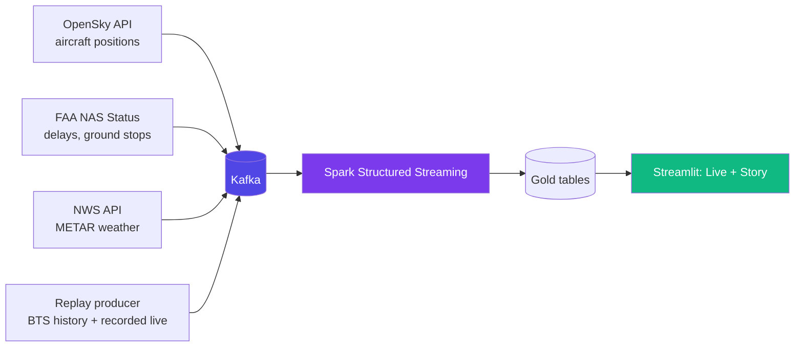

# 🛰️ HyperLogistics-Stream — Plan V2: Story Dashboard + Live Radar

**Supersedes the focus of:** [ENHANCED_IMPLEMENTATION_PLAN_STREAM.md](ENHANCED_IMPLEMENTATION_PLAN_STREAM.md) (its engine, model and benchmark steps still apply)
**Created:** Oct 29, 2026 · **Hard stop:** Nov 5 (submission Nov 9, so 4 days of buffer)
**Team:** Tony Nguyen, Joe Doan

> [!IMPORTANT]
> **Professor's guidance:** stay with **flight data** (freight/trucking data is too limited) and **make the data tell stories** that are useful to the audience.
> Flights remain a public proxy for hub-to-hub freight. State that limit plainly.

---

## 1. Chosen Direction

**Path 1 + Path 2:** Delay Story Dashboard + Live Airport Radar, using **both** live data and a replay fallback.

| Layer | What the audience sees |
|---|---|
| **Live Radar** | US hubs under stress *right now* (FAA status + weather + live aircraft) |
| **Story tabs** | "Why delays happen": worst lanes, worst hours, weather impact, hub ranking |
| **Today vs. typical** | Live conditions compared to the historical baseline for the same hub, hour and weekday |
| **Replay mode** | Famous disruption days replayed in real time, plus a recorded live session as a safety net |

**The headline demo sentence:** *"DFW is running 18 minutes worse than a typical Thursday evening, and here is why."*

---

## 2. Live Data Design

| Topic | Source | Poll rate | Note |
|---|---|---|---|
| `live_flights` | OpenSky | 30 s | Positions only, not delay minutes. Check current rate limits first |
| `airport_status` | FAA NAS Status | 60 s | Delays and ground stops (the best story signal) |
| `weather` | NWS API (METAR) | 5 min | Wind, visibility, ceiling per hub |
| `flights` (existing) | BTS replay | configurable | Historical baseline and replay mode |

**Failure rule:** if an API fails, hold the last known value and show a **"STALE"** badge. The dashboard never crashes or goes blank.

---

## 3. Ownership

| Plan | Owner | Focus | Deliverables |
|---|---|---|---|
| **Plan A: Insights and Engine** | Joe | Repeat-safe Gold writes, baselines, model + weather features, story analytics, benchmark | Clean replay, ablation table, insight metrics, benchmark charts |
| **Plan B: Live and Product** | Tony | Live producers, Spark live stream, Live Radar + Story tabs, demo, poster and video | Live feed, stale handling, dashboard, recorded session, 3-min video |

---

## 4. Schedule (Oct 29 → Nov 5)

> [!NOTE]
> **Goal: the live pipeline and dashboard work end to end by Sat Oct 31.** Nov 1–5 is for story polish, benchmark, recording and buffer. Estimated 3 to 5 hours per day each. Today is a short day.

### Thu Oct 29 (today): Prove the feeds

| Joe (Plan A) | Tony (Plan B) |
|---|---|
| Repeat-safe Gold writes and `--reset` in `pipeline/03_stream_processor.py` | Prototype 3 fetch scripts (OpenSky, FAA NAS, NWS). Print rows, check rate limits and schema |
| Confirm benchmark runs use a separate output root | Save raw sample responses to `data/live_samples/` |

**Done when:** each API returns usable data, and a clean replay has no repeated rows.

### Fri Oct 30: Live into Kafka and Spark

| Joe | Tony |
|---|---|
| Add weather features (wind, visibility, ceiling) to the model. Retrain and write the ablation table (`models/ablation.csv`) | `live_producer.py` publishing to `live_flights`, `airport_status`, `weather` |
| Build the **baseline table**: typical delay by hub × hour × weekday (from the training years) | Spark reads the live topics and joins weather and baseline into Gold |
| | Add the **stale-data fallback** (last known value + timestamp) |

**Done when:** live rows land in Gold with a weather join and a baseline column.

### Sat Oct 31: End to end (the deadline you set)

| Joe | Tony |
|---|---|
| Story metrics: "today vs. typical" delta per hub, plus the top 5 insights as plain text | Dashboard **LIVE/REPLAY toggle**, LIVE badge, last-updated time, STALE badge |
| Quick error analysis: where the model is wrong (hub, hour, weather) | Hub stress map colored by delta vs. typical. Click a hub for its story card |
| | **Start recording a live session** (leave it running for several hours) |

**Done when:** the dashboard runs live from the three feeds and shows "X is N min worse than typical."

### Sun Nov 1: Story tabs

| Joe | Tony |
|---|---|
| Story analytics: worst lanes, best/worst hours, seasonal heatmap, weather-impact chart | Story tabs in the dashboard with a one-line **"so what"** under each chart |
| Explainability (feature importance or SHAP) with a short plain-English summary | Insight cards ("ORD is 2.3× worse on Friday evenings") fed by Joe's metrics |

### Mon Nov 2: Replay mode and benchmark

| Joe | Tony |
|---|---|
| Run the **reduced benchmark** (cores, replay rate, shuffle partitions), one chunk at a time | **Replay mode:** choose 2 famous disruption days and a "Replaying: [date]" label |
| Save results to `benchmark/results` | Wire the **recorded live session** as the demo fallback |

### Tue Nov 3: Charts, tuning, freeze

| Joe | Tony |
|---|---|
| Three benchmark charts and **one headline sentence** from measured numbers | Latency tuning check on the live path (p95 before and after) |
| Freeze the model and write the README results section | Fix the bugs found in a fresh-run test from a clean clone |

### Wed Nov 4: Package

| Joe | Tony |
|---|---|
| Poster draft: problem, architecture, story results, limitations | Public demo (sample data so it works without live APIs) |
| Cross-check every number against the metrics files | 3-minute video script and first recording |

### Thu Nov 5: Hard stop, ship

| Both |
|---|
| Final video, poster and README. Fresh-clone test. Push to `origin`. Open the PR into `JoeDoan/HyperLogistic_Stream`. |

**Nov 6–9 is buffer only.** Do not plan features there.

---

## 5. Cut Line (drop in this order if time runs short)

1. SHAP/explainability (keep the plain feature-importance chart)
2. Seasonal heatmap
3. The natural-language agent from the earlier plan (already optional here)
4. Benchmark grid size (shrink it, keep the headline sentence)
5. Live OpenSky aircraft layer (keep FAA + weather, which carry the story)

**Protected, never cut:** clean replay, live FAA + weather feed, the "today vs. typical" story, stale-data fallback, recorded-session fallback, demo, poster and video.

---

## 6. Risks

| Risk | Mitigation |
|---|---|
| OpenSky rate limits or outage | Use a free account. Fall back to FAA + weather only. Fall back to the recorded session |
| API schema changes | Save raw samples on Day 1. Parse defensively |
| Live demo fails in front of judges | Recorded live session and a replay mode are ready |
| Over-claiming the freight link | Every slide says "flights are a public proxy" |
| Colab/Spark instability | Only one person runs retraining or the benchmark at a time |

---

## 7. Definition of Done (Nov 5)

- [ ] Live feed (FAA + weather, plus OpenSky if stable) runs through Kafka and Spark
- [ ] Dashboard shows LIVE/REPLAY, STALE badge, and "today vs. typical" per hub
- [ ] At least 4 story charts, each with a one-line "so what"
- [ ] Ablation table and benchmark headline match the metrics files
- [ ] Recorded live session and a replay day work offline
- [ ] README, poster and 3-minute video done
- [ ] A fresh clone runs the demo
